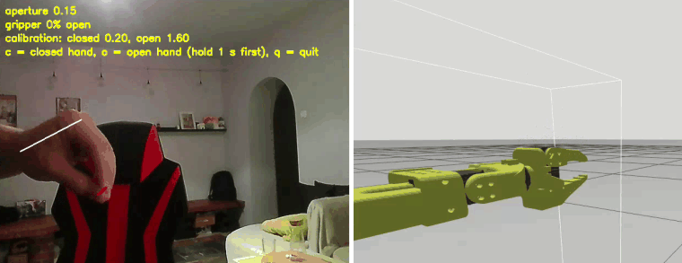
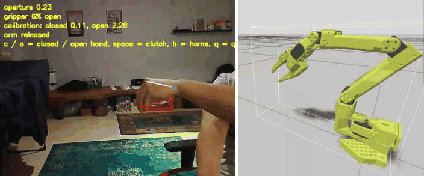

# so101_lerobot

Scripts for the **SO-101** arm on **ROS 2 Jazzy** (Ubuntu 24.04), simulation only for now:

- `so101_bringup/` — Gazebo, controllers, MoveIt and RViz with one command.
- `so101_hand/`, `so101_hand_ros/` — hand teleoperation from the webcam: closing the hand closes the simulated
  gripper, moving it moves the arm in its plane. Hand tracking (MediaPipe), measures, calibration, filters,
  kinematics and the clutch as a plain Python package with `pytest` tests, and a thin ROS 2 node (`hand_teleop`).
- `lerobot_teleop/run_teleop.py` — keyboard teleoperation of the simulated arm through LeRobot.
- `lerobot_mimic/` — legacy: the arm mirrors the operator's arm from a webcam (YOLO pose), see its README.

## Workspace

```
so101_ws/
├── .venv/                 # Python env (not in git)
└── src/
    ├── so101_lerobot/     # this repo
    ├── lerobot_ws/        # Pavankv92/lerobot_ws (Apache-2.0): description, controllers, MoveIt
    └── lerobot-ros/       # ycheng517/lerobot-ros (Apache-2.0): LeRobot ↔ ROS 2 bridge
```

Third-party repos are not copied here; they are pinned in `so101_lerobot.repos`:

```bash
cd so101_ws
vcs import src < src/so101_lerobot/so101_lerobot.repos
rosdep install --from-paths src --ignore-src -y
```

Built on top of a MoveIt 2 underlay (`moveit_ws`).

## Python environment

```bash
cd so101_ws
python3 -m venv .venv --system-site-packages
touch .venv/COLCON_IGNORE
.venv/bin/pip install -r src/so101_lerobot/requirements-lock.txt \
                      -r src/so101_lerobot/requirements.txt \
                      -c src/so101_lerobot/constraints.txt
.venv/bin/pip install --no-deps -e src/lerobot-ros/lerobot_robot_ros \
                                -e src/lerobot-ros/lerobot_teleoperator_devices \
                                -e src/so101_lerobot/so101_hand
```

The hand node needs the MediaPipe Hand Landmarker model (7.8 MB, Apache-2.0) in `$DATA_DIR/models`:

```bash
mkdir -p ~/data/models
curl -L -o ~/data/models/hand_landmarker.task \
  https://storage.googleapis.com/mediapipe-models/hand_landmarker/hand_landmarker/float16/latest/hand_landmarker.task
```

- `requirements.txt` — direct dependencies of these scripts.
- `requirements-lock.txt` — full pinned set (LeRobot, torch CUDA 12.8, …) without ROS packages.
- `constraints.txt` — keeps `opencv-python` and `opencv-contrib-python` (pulled in by MediaPipe) at a version
  compatible with ROS 2 Jazzy.
- `setuptools<80` is required by colcon.

## Build and run

```bash
source <moveit_ws>/install/setup.bash
source .venv/bin/activate
python -m colcon build
```

Simulation: Gazebo, controllers, MoveIt and RViz with one command (`source install/setup.bash` and the venv active):

```bash
ros2 launch so101_bringup sim.launch.py
```

MoveIt and RViz start after the controller spawner has exited. For debugging, the parts can still be
started separately, in this order: `lerobot_description so101_gazebo.launch.py`,
`lerobot_controller so101_controller.launch.py`, `lerobot_moveit so101_moveit.launch.py`.

The simulated robot is the upstream one with our controller configuration (`so101_bringup/config`, 100 Hz instead
of 10 Hz, ADR 0004): a joint reaches a goal in about 0.3 s instead of about 2 s.

The arm has 5 joints, so the RViz interactive marker (a full 6-DoF pose for KDL IK) rarely finds a solution:
set the goal with "Goal State" or tick "Approx IK Solutions" in the Planning tab.

Keyboard teleoperation (simulation running, venv active):

```bash
python src/so101_lerobot/lerobot_teleop/run_teleop.py
```

## Hand → gripper (stage 1)



The hand is lost for a moment and the gripper waits; then it opens and closes with the hand. Recorded with the
upstream controller configuration, so the gripper is about 1 s behind; now it is about 0.3 s (ADR 0004).

Close your hand to close the simulated gripper, open it to open the gripper. The pose: right forearm held across
the body, seen from the side by the webcam (ADR 0003); any view where the camera sees the thumb and the index
finger works.

```bash
ros2 launch so101_bringup sim.launch.py moveit:=false hand:=true
```

Gazebo starts first; the hand node and its preview window start once the controllers are active. The preview is
mirrored: the red line is the thumb–index gap, the white one the palm length it is divided by.

- Calibration: hold the closed hand still for a second and press `c`, then the open hand and `o`. The node prints
  `aperture_closed` and `aperture_open`; to keep them, put them in `so101_hand_ros/config/hand_teleop.yaml`
  (installed as a symlink, no rebuild needed). `q` closes the node; Gazebo keeps running.
- Hand lost for more than `hold_s` (0.5 s): the node stops sending goals and the gripper stays where it is.
- Goals never leave the joint range: a goal beyond the URDF limit would leave the simulated jaw stuck.
- Without a webcam, a recorded video is replayed in real time:
  `ros2 run so101_hand_ros hand_teleop --ros-args -p video_path:=<file> -p preview:=false`.

## Hand → arm (stage 2)



`space` engages the clutch and the wrist dot turns from grey to green; then the gripper follows the hand forward,
down and back. Real time, with our controller configuration (ADR 0004).

```bash
ros2 launch so101_bringup sim.launch.py moveit:=false hand:=true arm:=true
```

The gripper works as in stage 1. The arm first goes to a home pose (gripper 25 cm in front of the base, 15 cm
up, jaws 45° down). Then:

- `space` engages the clutch: the node latches where your wrist is in the image and where the gripper is. While
  engaged, the gripper moves like your hand (ADR 0003): stretching the arm, i.e. the hand to your left → forward,
  hand up → up, and the jaws tilt with your hand (below). Look at the robot in Gazebo from its left side, and the
  gripper moves on the screen like your hand in the mirrored preview. `space` again releases the clutch and the
  arm stops, so you can move your hand to a comfortable place and engage again, like lifting a mouse.
- Tilting the hand tilts the jaws (ROB-31): turn the white palm line in the preview (wrist → middle-finger
  knuckle) 20° down and the jaws turn 20° down (`pitch_gain` 1.0; 0.0 keeps the angle they had at engage). The
  jaws stay between −90° (straight down) and +30° (`bounds_pitch`), turn at most `max_step_rad` (about 3°) per
  frame, and the preview shows their angle.
- `h` releases the clutch and sends the arm home.
- Hand lost while the clutch is engaged: the arm stays, and so does the clutch. When the hand comes back somewhere
  else, the gripper goes to the matching place at up to `max_step_m` per frame (about 0.4 m/s); release the clutch
  first if you do not want that.
- The scale comes from MediaPipe (palm length in metres / in pixels), so the gripper moves as far as your hand
  (`gain` 1.0). Targets stay in the box `bounds_reach` × `bounds_height`, move at most `max_step_m` (2 cm) per
  frame and skip poses the arm cannot reach; when only the new jaw angle is out of reach, the gripper still
  moves and the jaws wait.
- The scale is taken when the clutch engages: rest the elbow on the desk in a marked spot, so the hand keeps its
  distance to the camera, and engage again after moving the elbow.
- The arm moves in its vertical plane: joints 1 (pan) and 5 (wrist roll) stay at 0, and our planar IK
  (`so101_hand/kinematics.py`) turns the target into joints 2–4. The TF frame `tcp` shows the point between the jaws.
- Without the keyboard: `ros2 service call /hand_teleop/clutch std_srvs/srv/SetBool "{data: true}"`.

Tests of the hand logic, no ROS or camera needed (venv active, in `so101_ws`):

```bash
python -m pytest src/so101_lerobot/so101_hand
```

GitHub Actions runs these tests on every pull request and push to `main` (`.github/workflows/tests.yml`),
without ROS or MediaPipe: the tracker tests are skipped there.

Model weights are read from `$DATA_DIR/models` (default `~/data/models`): `hand_landmarker.task`, `yolo26m-pose.pt`.
