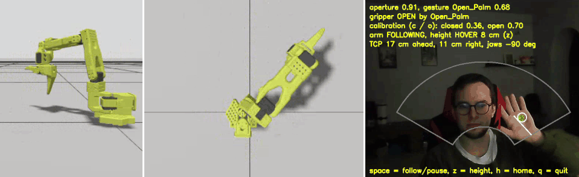
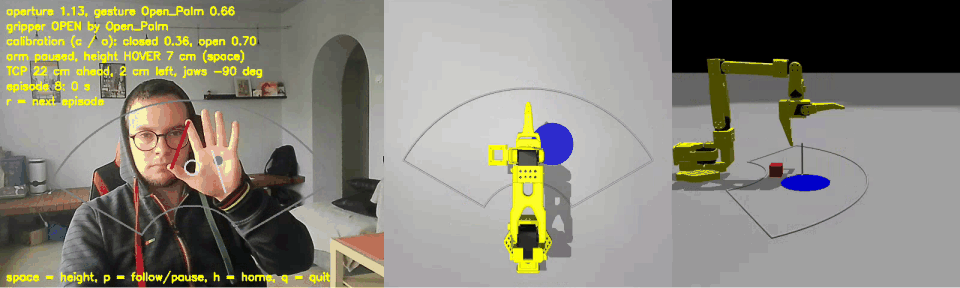
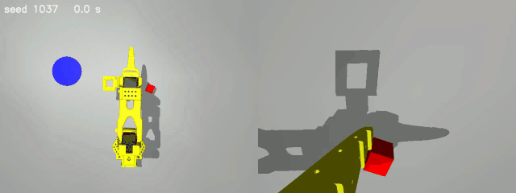

# so101_lerobot

Scripts for the **SO-101** arm on **ROS 2 Jazzy** (Ubuntu 24.04), simulation only for now:

- `so101_bringup/` — Gazebo, controllers, MoveIt and RViz with one command.
- `so101_hand/`, `so101_hand_ros/` — hand teleoperation from the webcam: closing the hand closes the simulated
  gripper, moving it moves the arm in its plane. Hand tracking (MediaPipe), measures, calibration, filters,
  kinematics and the clutch as a plain Python package with `pytest` tests, and a thin ROS 2 node (`hand_teleop`).
- `so101_mujoco/` — the same hand teleoperation without ROS, picking and placing a cube in MuJoCo (so101-nexus):
  50 recorded demonstrations and an ACT policy trained on them, 33 % success against the operator's 89 %.
- `lerobot_mimic/` — legacy: the arm mirrors the operator's arm from a webcam (YOLO pose), see its README.

## Workspace

```text
so101_ws/
├── .venv/                 # Python env (not in git)
└── src/
    ├── so101_lerobot/     # this repo
    └── lerobot_ws/        # Pavankv92/lerobot_ws (Apache-2.0): description, controllers, MoveIt
```

Third-party repos are not copied here; they are pinned in `so101_lerobot.repos`:

```bash
cd so101_ws
vcs import src < src/so101_lerobot/so101_lerobot.repos
rosdep install --from-paths src --ignore-src -y
```

Built on top of a MoveIt 2 underlay (`moveit_ws`).

## Python environment

```bash
cd so101_ws
python3 -m venv .venv --system-site-packages
touch .venv/COLCON_IGNORE
.venv/bin/pip install -r src/so101_lerobot/requirements-lock.txt \
                      -r src/so101_lerobot/requirements.txt \
                      -c src/so101_lerobot/constraints.txt
.venv/bin/pip install --no-deps -e src/so101_lerobot/so101_hand -e src/so101_lerobot/so101_mujoco
```

The hand node needs MediaPipe's Gesture Recognizer model (8.4 MB) in `$DATA_DIR/models`: the Hand Landmarker and a
classifier of the whole hand's gesture (ADR 0008). MediaPipe is Apache-2.0; the model card names no license for the
model file, so it is downloaded, not kept in the repository.

```bash
mkdir -p ~/data/models
curl -L -o ~/data/models/gesture_recognizer.task \
  https://storage.googleapis.com/mediapipe-models/gesture_recognizer/gesture_recognizer/float16/latest/gesture_recognizer.task
```

- `requirements.txt` — direct dependencies of these scripts.
- `requirements-lock.txt` — full pinned set (LeRobot 0.7, so101-nexus 0.11.0 with MuJoCo, torch CUDA 12.8, …)
  without ROS packages: `pip freeze --local --exclude-editable` run with `env -u PYTHONPATH`, because ROS's
  `PYTHONPATH` makes pip list its packages too.
- `constraints.txt` — keeps `opencv-python` and `opencv-contrib-python` (pulled in by MediaPipe) at a version
  compatible with ROS 2 Jazzy.
- `setuptools<80` is required by colcon.

## Build and run

```bash
source <moveit_ws>/install/setup.bash
source .venv/bin/activate
python -m colcon build
```

Simulation: Gazebo, controllers, MoveIt and RViz with one command (`source install/setup.bash` and the venv active):

```bash
ros2 launch so101_bringup sim.launch.py
```

MoveIt and RViz start after the controller spawner has exited. For debugging, the parts can still be
started separately, in this order: `lerobot_description so101_gazebo.launch.py`,
`lerobot_controller so101_controller.launch.py`, `lerobot_moveit so101_moveit.launch.py`.

The simulated robot is the upstream one with our controller configuration (`so101_bringup/config`, 100 Hz instead
of 10 Hz, ADR 0004): a joint reaches a goal in about 0.3 s instead of about 2 s.

The arm has 5 joints, so the RViz interactive marker (a full 6-DoF pose for KDL IK) rarely finds a solution:
set the goal with "Goal State" or tick "Approx IK Solutions" in the Planning tab.

## Hand → gripper (stage 1)


The hand is lost for a moment and the gripper waits; then it opens and closes with the hand. Recorded with the
upstream controller configuration, so the gripper is about 1 s behind; now it is about 0.3 s (ADR 0004).

Close your hand to close the simulated gripper, open it to open the gripper. The pose: the open right hand in front
of your chest, palm to the camera (ADR 0006; the GIF shows the earlier side view of ADR 0003); any view where the
camera sees the thumb and the index finger works. The gripper is open or closed, never in between (ADR 0008): a
fist closes it and an open palm opens it at once, whatever the thumb does (MediaPipe's gesture recognizer). Any
other hand, such as the "beak" (the thumb on the fingertips), is left to the thumb–index gap: the gripper closes at
the closed pose, opens at the open pose and keeps its state between them, so a trembling hand does not move it.

```bash
ros2 launch so101_bringup sim.launch.py moveit:=false hand:=true
```

Gazebo starts first; the hand node and its preview window start once the controllers are active. The preview is
mirrored: the red line is the thumb–index gap, the white one the palm length it is divided by. The first line shows
the gap and the gesture with its score, the second the gripper's state and what decided it, e.g.
`gripper CLOSED by Closed_Fist` or `gripper OPEN by aperture (closes at 0.36)`.

- Calibration of the gap (for the hands that are neither a fist nor an open palm): hold the closed hand still for a
  second and press `c`, then the open hand and `o`. The node prints `aperture_closed` and `aperture_open`, the two
  thresholds; to keep them, put them in
  `so101_hand_ros/config/hand_teleop.yaml` (installed as a symlink, no rebuild needed). `q` closes the node; Gazebo
  keeps running.
- Hand lost for more than `hold_s` (0.5 s): the node stops sending goals and the gripper stays where it is.
- Goals never leave the joint range: a goal beyond the URDF limit would leave the simulated jaw stuck.
- Without a webcam, a recorded video is replayed in real time:
  `ros2 run so101_hand_ros hand_teleop --ros-args -p video_path:=<file> -p preview:=false`.

## Hand → arm (stage 2): the hand over the workspace seen from above



The open hand brings the gripper over a spot, the height key lowers it, a fist closes the jaws, the key raises
them, the hand carries them to the left, the key lowers them and the open hand releases (12 s in real time,
2026-11-13; the height key was `z` then, it is `space` now).

ADR 0006, ADR 0007 and ADR 0008. The webcam sees you from the front; your open right hand in front of your chest,
palm to the camera, is the gripper seen from above. The preview shows the robot's workspace from above as a grey
ring sector (the arm's pan axis near the bottom edge, forward up the screen) and a white ring where the gripper is:
where your palm is in the sector is where the gripper goes over the table, the base turning with it. The height
comes from the key `space` (hover or grasp), the jaws point down, and a fist closes the gripper.

```bash
ros2 launch so101_bringup sim.launch.py moveit:=false hand:=true arm:=true
```

Two Gazebo windows open: the robot from its left side and, for aiming, from above, oriented like the preview
(forward up, the robot's right on the right). The arm first goes to the home pose (gripper 20 cm ahead of the pan
axis at the hover height, jaws down), paused. Then:

- `p` follows the hand: the palm dot in the preview turns from grey to green, the gripper goes to where the
  palm is at up to `max_step_m` per frame (about 0.4 m/s) and then follows it. Following starts only with the
  hand inside the sector (a red dot means outside: the target is rejected). `p` again pauses: the arm holds
  while you rest or move your hand.
- `space` toggles the height between `hover_height` (8 cm) and `grasp_height` (2 cm), travelled at up to
  `max_step_height_m` per frame (about 0.1 m/s); the preview shows the active one. Lower the gripper over the
  block, close your hand, raise, carry, lower, open.
- The jaws point straight down where the arm reaches it and tilt up to 45° near the edge of the sector
  (`pitch_range`); the preview shows their angle.
- `h` pauses and sends the arm home.
- Hand lost while following: the arm stays; when the hand is back, the gripper goes to it at the step limit.
- The mapping is set once in `so101_hand_ros/config/hand_teleop.yaml`: `px_per_m` (preview pixels per metre of
  table) and `axis_px` (where the arm's pan axis is in the raw 640×480 frame); the sector is `bounds_reach` ×
  `bounds_pan`. No depth is used anywhere (ADR 0007), so the distance to the camera only sets how far the hand
  travels.
- Our analytic IK (`so101_hand/kinematics.py`): the base angle (joint 1) from the target's direction, then the
  planar IK in the turned plane (joints 2–4), with the elbow bent by at least 30° (away from the stretched arm,
  where it would twitch); joint 5 (wrist roll) stays at 0. The TF frame `tcp` shows the point between the jaws.
- Without the keyboard: `ros2 service call /hand_teleop/clutch std_srvs/srv/SetBool "{data: true}"` follows,
  `false` pauses; `/hand_teleop/grasp` with `true` goes to the grasp height, `false` to the hover height.
- Without a webcam or a screen: `video:=<file> preview:=false headless:=true` (a recording, no windows).

The side view of M2 (ADR 0003: the hand moved the gripper in the arm's vertical plane with a clutch, the jaws
following the hand's pitch) is in the history, tag `v0.2-side-view`, with its [GIF](docs/media/hand_arm.gif).

Tests of the hand logic and of the MuJoCo scene, no ROS or camera needed (venv active, in `so101_ws`):

```bash
python -m pytest src/so101_lerobot/so101_hand
python -m pytest src/so101_lerobot/so101_mujoco
```

GitHub Actions runs them on every pull request and push to `main` (`.github/workflows/tests.yml`), without ROS
or MediaPipe: the tracker tests are skipped there.

Model weights are read from `$DATA_DIR/models` (default `~/data/models`): `gesture_recognizer.task`,
`yolo26m-pose.pt`.

## Pick and place in MuJoCo (M3)



The hand brings the gripper over the cube, `space` lowers it, a fist closes the jaws, `space` raises them, the hand
carries the cube over the disc, `space` lowers it and the open hand releases it: a success in 22.6 s (real time,
2026-11-14). In that first webcam test 7 of 7 pick and places succeeded (episodes skipped to look around not
counted), in 22.6–92.8 s; the last five took 28.5 s on average (22.6–37.2 s).

ADR 0009. The same hand teleoperation drives SO-101 in MuJoCo, without ROS: so101-nexus's `PickAndPlace-v2`
(a 25 mm cube and a blue disc of 5 cm radius, both placed inside the workspace sector). Pick the cube up and put it
on the disc, then open your hand and raise the gripper: the task counts a success when the cube rests on the disc,
released, for 0.2 s.

```bash
so101_mujoco                       # venv active; or: .venv/bin/so101_mujoco
```

One window: the preview (as for Gazebo) and the scene from above (the base at the bottom, the robot's right on the
right, like the preview) and from the robot's right side, with the sector drawn on the floor and a cross where the
gripper is going (green while following). The simulation runs in real time with the camera.

- Keys: `p` follows or pauses, `space` toggles the height (hover 7 cm, grasp 1.25 cm: the cube's centre, both above
  the floor), `h` home, `c` / `o` calibration, `r` the next episode (another cube and disc), `q` quit.
- A success shows the time since the episode began; with the webcam it is also added to
  `$DATA_DIR/so101_mujoco/pick_and_place.csv`.
- Without a webcam or a screen: `so101_mujoco --video <file> --follow --headless out.mp4` (the window is written
  to a video; `--follow` starts following once the hand is in the sector).
- The TCP is the middle of the open jaws, 12 mm off the wrist roll axis (`so101_hand/kinematics.py`): a top-down
  grasp of so101_hand's IK straight above the cube lifts it in 37 of 40 random scenes; on the axis it was 0–4 of 20.
- MuJoCo's world and so101_hand's frame differ by a shift (`so101_mujoco/world.py`): the Gazebo base frame lies
  32.5 mm below MuJoCo's floor, and so101-nexus's wrist roll is the Gazebo joint 5 + 0.0487 rad.

### Recording the demonstrations

ADR 0010. With `--record`, every attempt becomes an episode of a LeRobot v3 dataset in the real SO-101 follower's
schema (joints in degrees, the gripper 0–100, the wrist and overhead cameras at 30 fps):

```bash
so101_mujoco --record <hf_user>/so101_pick_place
```

- An attempt starts with your first `p` and is saved 1 s after the success (released on the disc, the gripper
  raised); the next cube follows. `r` gives an attempt up: it is discarded and counts as a failure; before `p` it
  only skips the scene. Saving encodes the two videos in a few seconds.
- `q` finishes: an attempt in progress is discarded, and the dataset is closed. The same command later adds to it,
  with new cube positions.
- The dataset goes to `$HF_HOME/lerobot/<repo_id>` (`~/data/huggingface/lerobot/…`), outside git; every attempt is
  a row of `$DATA_DIR/so101_mujoco/so101_pick_place_attempts.csv` (saved or discarded, seconds, frames), from which
  the metrics come.

The dataset (2026-11-14, two sessions, ROB-39): 50 episodes, 31,460 frames (17.5 min at 30 fps, 171 MB), the cube
and the disc from seeds 0–55 inside the workspace sector.

- Teleoperation success rate: 50 of 56 attempts (89 %); the 6 failures were given up with `r`.
- Time per pick and place, from the first `p` to the success: 20.0 s on average (SD 10.0 s), median 17.8 s, half of
  them within 13.7–22.4 s, 7.7–59.6 s in all. The median fell from 20.1 s in the first session (20 episodes) to
  16.4 s in the second (30). In the longest (59.6 s) the cube started under the arm at home, hidden from above.

## ACT policy (M4)

ROB-40. LeRobot's ACT (Action Chunking with Transformers) learns from the demonstrations: from the two cameras and
the joints it predicts the next 100 joint targets (3.3 s), and `so101_mujoco_eval` runs it in the same MuJoCo scene.

### Training

```bash
# the venv active, in so101_ws; the dataset is local, so nothing is fetched from the Hub
HF_HUB_OFFLINE=1 lerobot-train \
  --dataset.repo_id=PiotrKonopkaRobotyka/so101_pick_place \
  --policy.type=act --policy.device=cuda --policy.push_to_hub=false \
  --policy.input_features='{"observation.state": {"type": "STATE", "shape": [6]},
    "observation.images.wrist": {"type": "VISUAL", "shape": [3, 480, 640]},
    "observation.images.overhead": {"type": "VISUAL", "shape": [3, 480, 640]}}' \
  --accelerator.mixed_precision=bf16 \
  --output_dir=$HOME/data/models/so101_act --steps=50000 --save_freq=5000
```

- `--policy.input_features` lists the policy's inputs. Without it LeRobot also gives ACT
  `observation.environment_state`, the simulator's poses of the cube and the disc, which a real arm does not have.
- Otherwise ACT's defaults: batch 8, learning rate 1e-5, chunks of 100 actions. On the RTX 4060 Laptop (8 GB) the
  50,000 steps (12.7 epochs of the 50 episodes) took 3 h 31 min: 4.2 steps/s in bf16 (3.4 in fp32, with the same
  loss), 3.6 GB of GPU memory allocated, 4.6 GB in `nvidia-smi`. A checkpoint takes 0.6 GB, of which 0.2 GB is the
  policy (`pretrained_model/`) and the rest the optimizer's state.
- A run that stops continues from its last checkpoint: `lerobot-train --resume=true
  --config_path=<output_dir>/checkpoints/last/pretrained_model/train_config.json`.
- `lerobot-train` needs `accelerate` (in `requirements.txt`); ResNet18's ImageNet weights are downloaded once, into
  `~/.cache/torch`.

### Evaluation in MuJoCo

```bash
so101_mujoco_eval ~/data/models/so101_act/checkpoints/last/pretrained_model    # 50 episodes, seeds 1000-1049
so101_mujoco_eval <the same> --episodes 3 --video act.mp4                      # what the policy saw
```

- Every episode starts as the recorded ones: a new cube and disc (seeds from 1000; the recordings' start at 0), the
  arm at home, the gripper open. Each step (30 Hz) the policy gets the two cameras and the joints in the dataset's
  units and returns the joint targets; an episode ends with the task's success or after 60 s (the demonstrations
  took 7.7–59.6 s, median 17.8 s).
- The task's success is the cube resting on the disc, released: it does not ask how the cube got there, and in 6 of
  these 50 scenes the cube starts within 8 cm of the disc's centre (the success radius is 5 cm). So every episode
  also records how far the cube rose: a success with at least 20 mm is a cube carried, not pushed.
- Each episode is a row of `$DATA_DIR/so101_mujoco/eval.csv` (time, checkpoint, seed, success, seconds, lift_mm).
- `--temporal-ensemble 0.01` predicts a chunk at every step and averages the overlapping ones (the ACT paper's
  inference) instead of running each chunk of 100 actions to its end, LeRobot's default.
- `--device cpu` runs the policy on the CPU, e.g. while a training uses the GPU (about 75 simulated steps/s).

### Results



The policy after 50,000 steps picks the cube and places it on the disc in 14.8 s (seed 1037, real time; the two
images are all it sees besides its joints). Over the 50 evaluation scenes (2026-11-16):

| | Success | Time to success |
| --- | --- | --- |
| Teleoperation (the demonstrations) | 50 of 56 (89 %) | 20.0 s mean, 17.8 s median |
| ACT, 50 episodes, 50,000 steps | 17 of 50 and 16 of 50 (33 %) | 31.8 s mean, 27.8 s median |

- The two ACT numbers are two runs of the same checkpoint on the same 50 scenes. A scene's outcome is not
  repeatable: tiny numerical differences on the GPU grow in the closed loop, so only 8 scenes succeeded in both
  runs, 25 in at least one and 25 in neither. One run of 50 episodes is good to about ±13 points (95 %).
- The successes are real pick and places: all 16 of the second run carried the cube (the first run did not record
  it yet), as 49 of the 50 demonstrations did. In 6 of its 34 failures the cube was lifted but not placed; in the
  other 28 it rose 10 mm at most: touched or tipped over, never grasped.
- During the training (one run each, the policy on the CPU): 7, 14, 9, 15 of 50 after 10,000, 20,000, 30,000,
  40,000 steps. From 20,000 steps on the differences are within the noise.
- More demonstrations helped more than more steps: the pilot on the first 20 episodes reached 0 to 3 of 50
  (20,000 steps, the same loss).
- Temporal ensembling was worse here, 10 of 50 (20 %, one run).

## Limitations

Limits of the method, known by design (ADR 0003, ADR 0005, ADR 0006, ADR 0007):

- One webcam, depth from one camera: the hand is measured well across the image and poorly along the camera's axis.
  Measured in ROB-34 (ADR 0007): the depth from MediaPipe's landmarks (palm scale, solvePnP, 21-point scale) is
  precise while the hand holds its pose (σ ≤ 0.5 cm at 41–69 cm) but every change of the pose reads as depth:
  closing the hand +10 cm, tilting the fingers 40–60° +13 to +48 cm, moving the hand 10 cm across the image up to
  +10 cm. So no axis is driven by the depth: from the front (ADR 0006) aiming over the table is in the image plane
  and the gripper's height comes from a key. (In the side view of M2, tag `v0.2-side-view`, the image plane was
  the arm's plane, so the arm moved only in that plane, with the scale latched when the clutch engaged.)
- Frontal pose: the camera must see the thumb and the index finger, and a fist hides them for a moment, which the
  EMA and the hold cover (ROB-19: open told from closed in 97.6–100% of frames from the front).
- The arm follows the hand only while following (`p`, or the service), and the pause is a key, not a gesture;
  following starts only with the hand inside the sector. The hand's position maps to the table in pixels, so the
  mapping is set once for one camera placement (`px_per_m`, `axis_px`).
- No wrist roll: joint 5 stays at 0, and the jaws point down (a top-down grasp) where the arm reaches it, tilting
  up to 45° elsewhere (the wrist flex limit): the block is grasped from above, within a part of the workspace.
- Grasping only in MuJoCo (`so101_mujoco`), not in Gazebo: the Gazebo stages move the gripper and the arm with no
  objects to pick. Recording demonstrations for training is planned in MuJoCo (ADR 0005, ROB-39).
- Simulation only: no real SO-101 has been driven yet.
