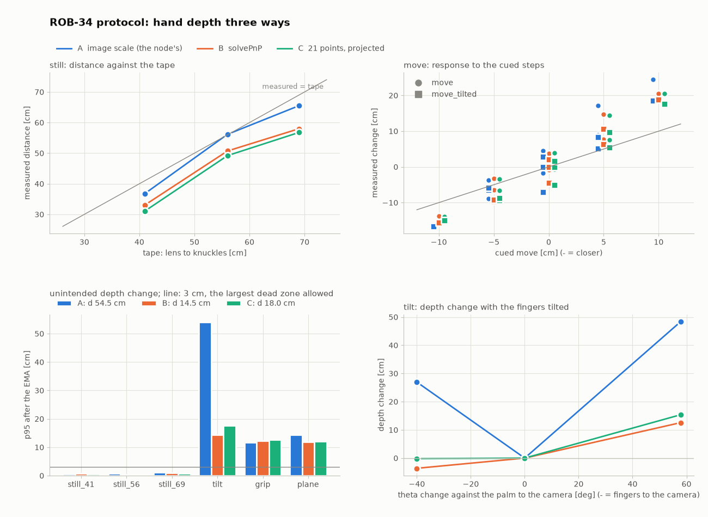

# 0007. Gripper height from the keyboard: the hand's depth from one camera is not robust enough

- Status: Accepted (the spike ROB-34, measured on 2026-11-11)
- Date: 2026-11-11
- Amends: ADR 0006 (the height from the hand's depth; the hand's position in metres at its depth)

## Context

ADR 0006 left one axis to the hand's depth: the gripper's height, pushed down when the hand comes nearer the camera,
if the spike ROB-34 found the depth precise enough; otherwise keys. The rule was set before the data (2026-10-28):
the dead zone d of a method is the largest unintended change of its depth (p95 after the node's EMA) while the hand
stands still, tilts, closes or moves across the image; the depth drives the height if d ≤ 3 cm and a 10 cm move reads
at least 2 d the right way.

Three ways to the depth were measured from the front (the pose of ADR 0006) with the webcam as the node opens it
(640×480, 19.7 fps) and a focal length of 500 px: A the image scale the node already has (f × the palm length in
MediaPipe's world landmarks / in pixels), B `cv2.solvePnP` of the 21 world landmarks against the 21 image landmarks,
C the same scale from all 21 points projected on the image. Code in `~/code/experiments/hand_depth_spike/`
(`record.py`, `depth.py`, `analyse.py`), recordings and results in `~/data/hand_depth_spike/`.

- Still at 41, 56 and 69 cm (tape, lens to knuckles): noise σ 0.1–0.5 cm after the EMA. A reads 37 / 56 / 66 cm,
  B 33 / 51 / 58, C 31 / 49 / 57; each scale factor is constant within ±6–8%, so f and MediaPipe's hand size cancel
  into a gain, as expected.
- Moves of 5 and 10 cm towards and away, by eye: always the right way, 1.0–2.2 times the cue, in all three methods
  alike, so the hand moved more than cued.
- But every change of the hand's pose reads as depth, in all three methods. The hand closed: +10 to +12 cm (a fist
  foreshortens the palm by 20% in the image, while the world landmarks see only a 20° tilt). The fingers 40° towards
  the camera: A +27 cm (B −4, C 0); 58° away: A +48, B +13, C +15 cm. The hand 10 cm to the right: +10 cm in all
  three; 10 cm down, at the bottom of the frame: A +9, B +4, C +3 cm.
- Dead zones by the rule: A 54.5 cm, B 14.5 cm, C 18.0 cm, against the 3 cm allowed. A fourth try, a fixed hand size
  with the image palm length alone, is worse (closed +14 cm, tilted +37 cm): the foreshortening is the very thing
  that changes.

The depth is precise while the pose holds and useless when it changes; closing the hand and moving it across the
image are the task's own motions, so the height would jump by 10 cm at the grasp.

## Decision

- The hand's depth drives nothing. The gripper's height comes from the keyboard: one key toggles between two
  heights, hover and grasp (parameters; the hover as high as the top-down grasp allows, ADR 0006), and the gripper
  travels between them at a limited rate; the preview shows which one is active.
- The hand's position for XY is taken in pixels of the image and mapped to the table once (pixels per metre and an
  offset): no depth in the loop at all. ADR 0006's position in metres at the hand's depth is dropped: a depth that
  swings ±15% with the pose would add that error to XY.
- The image scale of ADR 0003 (metres per pixel at engage) is not needed in the frontal mapping either; the world
  landmarks remain only the fallback measure of the gripper (ADR 0003).
- solvePnP and the world landmarks stay out of the node; the spike's code stays in `~/code/experiments/`.
- The README's Limitations state the numbers (ADR 0005: the depth from one camera is the method's limit, measured
  and stated).

## Rejected or deferred

- The depth with a larger dead zone (15–20 cm): the usable push would be 20 cm or more at a 55 cm distance, and the
  grasp itself (closing the hand) would move the gripper by 10 cm.
- Latching the height while the hand closes: it would hide the grasp's jump but not the +10 cm of moving the hand
  across the image, which is the aiming itself.
- A chessboard calibration of the camera: the scale factor is constant over the distances within ±8%; the problem is
  the hand's pose, not f.
- A One Euro filter: the swings are pose changes, not noise (σ ≤ 0.5 cm); ROB-37 stays for the jitter.
- The height from the hand's vertical position, or a second camera: ADR 0006 and ADR 0005.

## Consequences

- ROB-35 builds the height from the key and XY in pixels; the clutch's metres per pixel and the world landmarks leave
  the arm path.
- The other hand presses two keys: `space` for the pause and the height toggle; the same keys in MuJoCo (ROB-38).
- Depth from one camera is stated in the README with the numbers; a depth camera remains out of scope (ADR 0005).
- The protocol and the scripts can be re-run in a session for another camera or hand model (a newer MediaPipe).
